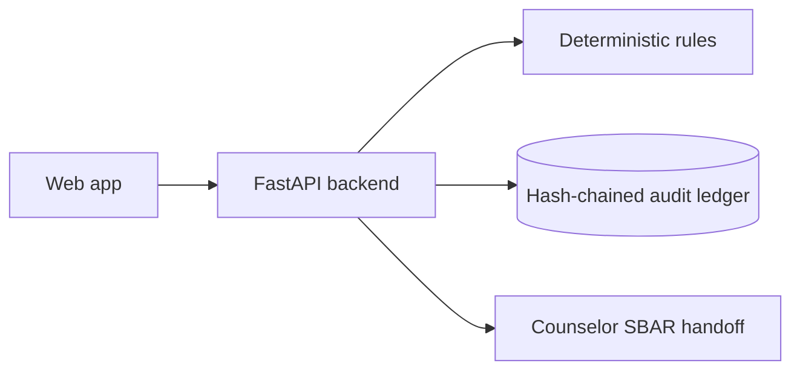

# Consent-first carrier care

Prototype for the Future Health Digital Innovation Challenge (Challenge 03: inherited disease risk). **Synthetic data only. Education and decision support, not clinical advice.**

Helps couples understand carrier screening results in plain, non-judgmental language (English and Arabic), keeps each partner's results private unless both consent, and routes serious or uncertain findings to a human genetic counselor.



## Run
```
cd backend
pip install -r requirements.txt
uvicorn app.main:app --reload      # open http://localhost:8000
```
The backend serves the web app at `/`. API docs are at `/docs`. Every tab now runs on the API when it is reachable. Use "View as Partner A/B" on Private match, the **Staff** tab (demo tokens `counselor-demo`, `coordinator-demo`), and the **Server** tab for a full check.
Set `COUNSELOR_TOKEN` and `COORDINATOR_TOKEN` environment variables; the defaults are demo values only.

## Test
```
cd backend
pytest -q
python eval/run_eval.py      # writes eval/eval_report.md
```
The evaluation checks engine correctness, privacy (no leakage of unilateral carrier status, 5,000 random trials), language safety (no directive or stigmatizing wording), and readability.

## Design principles
- A deterministic engine computes risk. No language model computes or invents risk figures.
- Relatedness never changes a carrier couple's 1-in-4 risk.
- Consent is required from both partners; revoking it locks the view again.
- The audit ledger is append-only and hash-chained, and never stores genetic results.
- Cancelled marriages are never a success measure.

## Limits
- The server holds both partners' results and releases the match only after both consent. This is **not** private set intersection; real PSI is future work.
- Authentication uses simple tokens. Not production-ready.
- Wording (English and Arabic) is awaiting clinical and native-speaker review.
- Comprehension, counseling uptake and time to referral are not yet measured and need real participants.
- Scope: recessive carrier screening before pregnancy only.

## Features (prototype)
- Private match with server-side, per-gene consent gating (each partner chooses which genes are shared); "View as Partner A/B" shows what each partner can see
- Private family-history questions (Yes, No or Not sure) that route to a genetic counselor or doctor without changing the couple view
- Staff sign-in (counselor, coordinator), counselor queue with priority, SBAR handoff, referral stages
- Privacy page: consent history, withdraw consent, delete my data
- Tamper-evident audit ledger, FHIR-style export (no genetic results), pilot metrics (demo data)
- Audio narration (browser speech), larger text, high contrast, English and Arabic with right-to-left layout
- Comprehension self-check with anonymous score tracking
Not included: Urdu (needs clinical and language review), offline app, any real health-system integration.
- Counselor intake brief: one page with a pseudonymous case reference, shared genes and the couple's own questions (pseudonymous, not anonymous)
