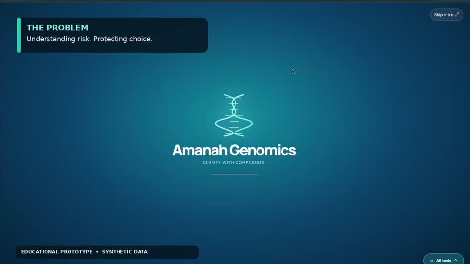
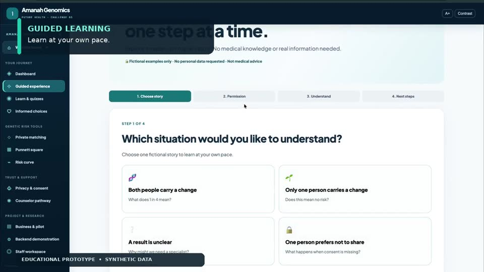
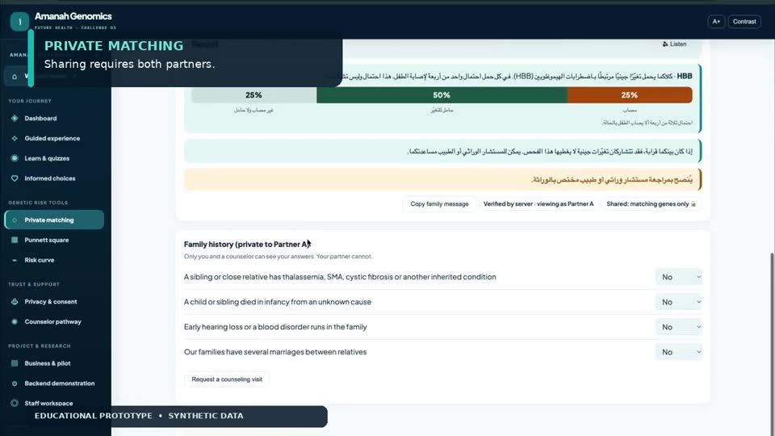
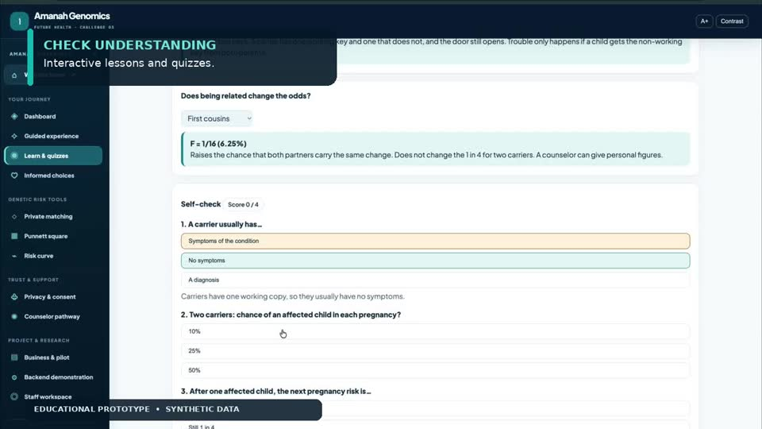
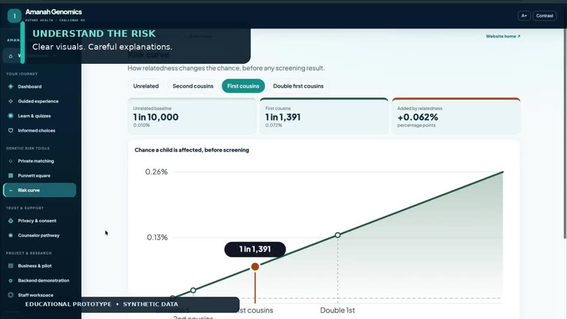
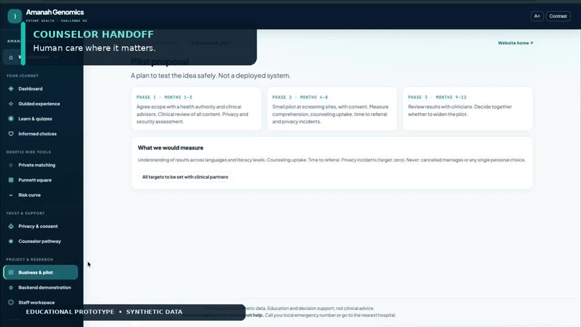
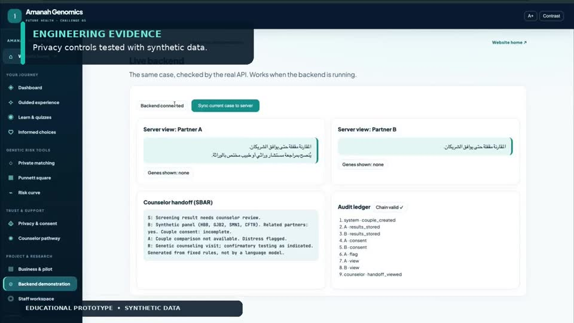
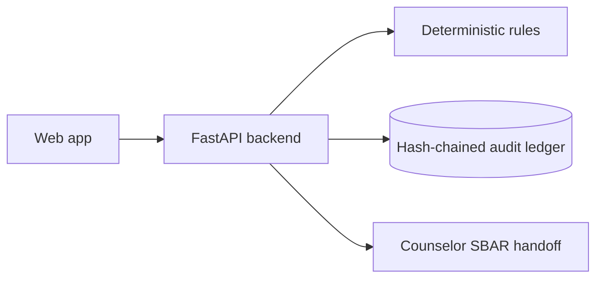

# Amanah Genomics
**Understand Together. Share by Choice.**

> **Synthetic-data educational prototype.** Not a diagnostic service, clinical device, genetic test, or real patient portal.

A bilingual English/Arabic, consent-first carrier-screening **education and demonstration platform** built for the Abu Dhabi Future Health Digital Innovation Challenge, Fertility Challenge 03.

[Live synthetic demo](https://amanah-genomics-demo.onrender.com/) · [Demo video instructions](media/README.md) · [Architecture](docs/ARCHITECTURE.md) · [Security limits](docs/THREAT_MODEL.md) · [Claims and evidence](docs/SUBMISSION_CLAIMS_ALIGNMENT.md)



## Real application walkthrough

| Guided learning | Consent and privacy |
|:---:|:---:|
|  |  |
| **Quiz** | **Risk education** |
|  |  |
| **Counseling demonstration** | **Engineering evidence** |
|  |  |

## Key features and evidence

| Feature | Status |
|---|---|
| Patient journey, quizzes, Risk Curve, Punnett Square | **Built** for synthetic educational use |
| Dual-partner consent and per-gene sharing | **Backend implemented**, locally tested on synthetic cases |
| Withdrawing consent locks authorized comparison | **Backend regression test included** |
| English/Arabic and RTL | **UI implemented**; independent Arabic clinical review pending |
| Counselor guidance and queue | **Demonstration only**; no clinical booking/referral |
| Hash-chained audit and FHIR-style export | **Prototype implementations**; no UAE integrations |
| Business model and pilot | **Hypotheses only**, no signed clinical partnerships |
| Live deployment | **Public synthetic demo available on Render**; latest commit and endpoint health should be checked before judging |
| Formal clinical validation | **Not completed**; five statements received limited external factual review |

**Test evidence:** local runs have reported 18–19 backend tests across different revisions, plus a dated report of 37 synthetic evaluation checks and 5,000 randomized privacy trials for scoped consent behavior. These are not the same test category. Re-run CI on the submitted commit rather than treating an older count as current. No clinical outcomes were measured.

## Local run (macOS/Linux)

```bash
cd backend
python3 -m venv .venv
source .venv/bin/activate
python -m pip install -r requirements.txt
python -m uvicorn app.main:app --reload
```

Open http://127.0.0.1:8000/ and http://127.0.0.1:8000/advanced.html. Check http://127.0.0.1:8000/health.

## Test

```bash
cd backend
python -m pytest -q
python eval/run_eval.py
```

## Deploy demo

**Public demo:** https://amanah-genomics-demo.onrender.com/ (synthetic cases only). This is a public prototype deployment, **not** a clinical production deployment. Render's free service can sleep while idle; SQLite data on ephemeral storage can reset during restarts/deploys. Check `/health` and the live consent checks on the deployed commit. Never enter real patient data. Authentication and encryption are not hospital-production ready.

## Repository layout

- `frontend/` — connected web experience
- `backend/app/` — FastAPI, consent/rule engine, database
- `backend/tests/`, `backend/eval/` — test and synthetic evaluation cases
- `docs/` — architecture, threat model, safety/claims, pilot assumptions
- `assets/screenshots/` — real demonstration visuals
- `media/` — narrated application walkthrough

---

## Additional implementation notes

# Consent-first carrier care

Prototype for the Future Health Digital Innovation Challenge (Challenge 03: inherited disease risk). **Synthetic data only. Education and decision support, not clinical advice.**

Helps users explore fictional carrier-screening scenarios in English and Arabic. The backend enforces partner consent for specified shared-result workflows and offers a demonstration counselor queue; it does not make a live clinical referral or appointment.



## Run
```
cd backend
pip install -r requirements.txt
uvicorn app.main:app --reload      # open http://localhost:8000
```
The backend serves the web app at `/`. API docs are at `/docs`. Private match, Triage, Privacy, Staff and Server run on the API when it is reachable. Overview, Punnett, Learn, Risk curve, Options and Pilot are static pages. Use "View as Partner A/B" on Private match, the **Staff** tab (use the configured, role-specific demo tokens; do not publish live secrets) and the **Server** tab for a full check.
Set distinct `COUNSELOR_TOKEN` and `COORDINATOR_TOKEN` environment variables in Render; never commit or share secret token values.

## Test
```
cd backend
pytest -q
python eval/run_eval.py      # writes eval/eval_report.md
```
The evaluation checks engine correctness, privacy (no leakage of unilateral carrier status, 5,000 random trials), language safety (no directive or stigmatizing wording), and readability.

## Design principles
- A deterministic engine computes risk. No language model computes or invents risk figures.
- Relatedness never changes a carrier couple's 1-in-4 risk.
- Consent is required from both partners; revoking it locks the view again.
- The audit ledger is append-only in the application and hash-chained, and never stores genetic results. Withdrawing consent locks the view; "Delete my data" removes the rows. See the claims audit for exact semantics.
- Cancelled marriages are never a success measure.

## Limits
- The server holds both partners' results and releases the match only after both consent. This is **not** private set intersection; real PSI is future work.
- Authentication uses simple tokens. Not production-ready.
- Wording (English and Arabic) is awaiting clinical and native-speaker review.
- Comprehension, counseling uptake and time to referral are not yet measured and need real participants.
- Scope: recessive carrier screening before pregnancy only.

## Verification and status legend

- **[Built]** Implemented in the repository; this does not guarantee clinical safety or successful public deployment.
- **[Tested on synthetic data]** Supported by automated cases or the recorded evaluation report, not real patient outcomes.
- **[Demonstration only]** Simulated feature with no live clinical service or production integration.
- **[Planned / unconfirmed]** Future work, not a committed clinical partnership or scheduled review.

**Recorded synthetic evidence:** earlier runs report 18 or 19 backend tests depending on revision; `backend/eval/eval_report.md` records 37/37 scoped synthetic evaluation checks, including 5,000 randomized privacy trials. Exact current pass counts must come from the successful CI run of the submitted commit. This is engineering evidence, not clinical validation.

## Features (prototype)
- Private match with server-side, per-gene consent gating (each partner chooses which genes are shared); "View as Partner A/B" shows what each partner can see
- Private family-history questions (Yes, No or Not sure) that route to a genetic counselor or doctor without changing the couple view
- Staff sign-in (counselor, coordinator), counselor queue with priority, SBAR handoff, referral stages
- Privacy page: consent history, withdraw consent, delete my data
- Counselor intake brief: a one-page summary with a pseudonymous case reference, shared genes and the couple's own questions (pseudonymous, not anonymous)
- Tamper-evident audit ledger, FHIR-style export (no genetic results), pilot metrics (demo data)
- Audio narration (browser speech), larger text, high contrast, English and Arabic with right-to-left layout
- Comprehension self-check with anonymous score tracking

Not included: Urdu (needs clinical and language review), an offline app, and any real health-system integration.

## Platform and integrations: implemented vs future

- **[Built]** Python FastAPI, SQLite demonstration database, deterministic inheritance rules, consent checks, application-level hash-chained audit ledger and FHIR-style export.
- **[Demonstration only]** Guided patient onboarding, simulated partner permissions, counselor queue, referral stages, and synthetic pilot metrics. The guided homepage is not equivalent to the backend-enforced permission workflow.
- **[Planned / unconfirmed]** Real provider deployment, independent clinical safety validation, independent native-Arabic medical review, FHIR conformance validation, production authentication, database hardening, and integration with UAE Pass, Malaffi or clinical systems. None is scheduled or contracted unless separately confirmed in writing.

## Independent academic input (November 19, 2026)

A PhD academic working in human genetics/gene therapy provided **genuine written educational feedback** on five questions about inheritance risk, referral criteria, VUS, privacy and consent, and counselor-intake information. The response was **informal and literature-informed**; the reviewer asked that the suggestions be double-checked. Their name and original correspondence are not published here without attribution permission. This is **not** completed clinical validation or product endorsement. See [feedback summary and action items](docs/INDEPENDENT_ACADEMIC_FEEDBACK_2026-11-19.md).

## Evidence and review status
- Every clinical statement is listed with a published source in an evidence map (see the submission documents).
- A molecular geneticist checked five key statements for facts and clarity. This was not a clinical review or an endorsement.
- No completed independent clinical review or Arabic medical-language review is documented in this package. Requests to genetics professionals have been sent; a request or invitation is not a scheduled review or endorsement.

## Documentation
- [Architecture](docs/ARCHITECTURE.md)
- [Threat model](docs/THREAT_MODEL.md)
- [Error analysis log](docs/ERROR_LOG.md): what went wrong, how it was found, how it was fixed
- [Claims audit](docs/CLAIMS.md): every claim, how it is checked, and what we do not claim
- [Deployment](docs/DEPLOYMENT.md)
- Docker: `docker compose up --build`


## Business & pilot pathway (new)

The patient homepage includes a bilingual, explicitly hypothetical **Business & pilot** section with a cost/revenue scenario calculator, customer segmentation, research/pilot milestones and honest evidence status. This addition leaves graph, quiz and advanced workflows unchanged. See `docs/COMMERCIAL_VIABILITY_AND_PILOT.md`.

## Submission deployment evidence (November 2026)

- **Public synthetic demo:** https://amanah-genomics-demo.onrender.com/
- **Health endpoint:** https://amanah-genomics-demo.onrender.com/health — check immediately before judging; an idle free-tier service may take time to wake.
- **Repository & CI:** [GitHub repository](https://github.com/eemanefatimaawan567-glitch/carrier-care) and [workflow runs](https://github.com/eemanefatimaawan567-glitch/carrier-care/actions). CI is configured to run backend tests and evaluation on pushes; verify the latest run's status, do not assume a pass.
- **Demonstrated behavior:** synthetic bilateral consent, withdrawal checks (3/3 in a prior live demonstration), counselor handoff and coordinator referral progression. Recheck on the final deployed commit.
- **Reproducibility:** Dockerfile, `render.yaml`, [deployment guide](docs/DEPLOYMENT.md), [architecture](docs/ARCHITECTURE.md), and [threat model](docs/THREAT_MODEL.md).
- **Environment limits:** ephemeral SQLite, no production auth hardening, backup strategy or independent penetration test. Do **not** enter real patient data.

### Planned migration path (not implemented)

1. Move to managed PostgreSQL with encryption at rest, backups and a migration strategy.
2. Replace demo tokens with individually managed identities, expiring sessions and stronger authorization, then conduct an independent security review.
3. Add monitoring, incident response, load testing and deployment rollback procedures.
4. Seek clinical governance, native Arabic medical review and provider-approved interoperability before any real-patient pilot. UAE Pass/Malaffi integration is a future possibility, not a connected service.

### Commercial and pilot evidence

Patients receive free educational access in the proposal; prospective institutional customers are screening centres and fertility/genetics providers. AED 750/facility/month is a **pricing hypothesis**, not a validated market price. At five hypothetical subscribing facilities, gross revenue would be AED 3,750/month and AED 45,000/year. An assumed AED 250/facility/month variable cost gives AED 30,000/year contribution **before** fixed, clinical, compliance, sales and integration costs. See [commercial viability and pilot pathway](docs/COMMERCIAL_VIABILITY_AND_PILOT.md).
