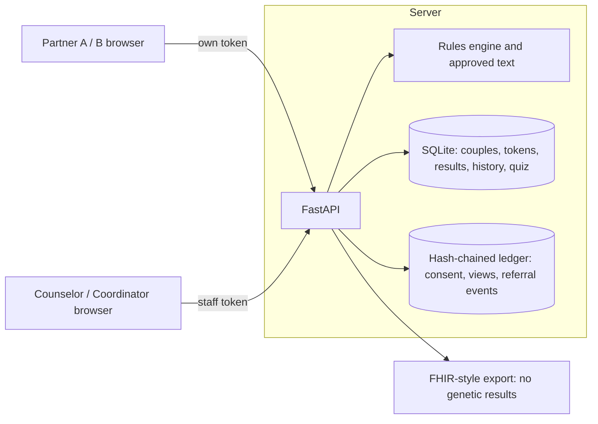
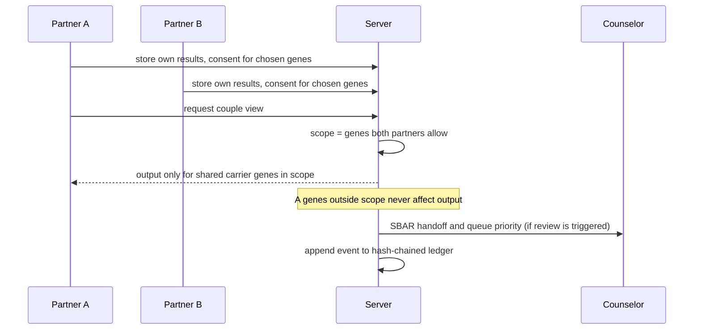

# Architecture

## Consent-gated match

## Where a health system would connect later
- Results would arrive from an accredited laboratory (today: entered by hand, synthetic).
- Referrals would leave as FHIR resources (today: FHIR-style export only, nothing transmitted).
- No integration with any health information exchange exists.
